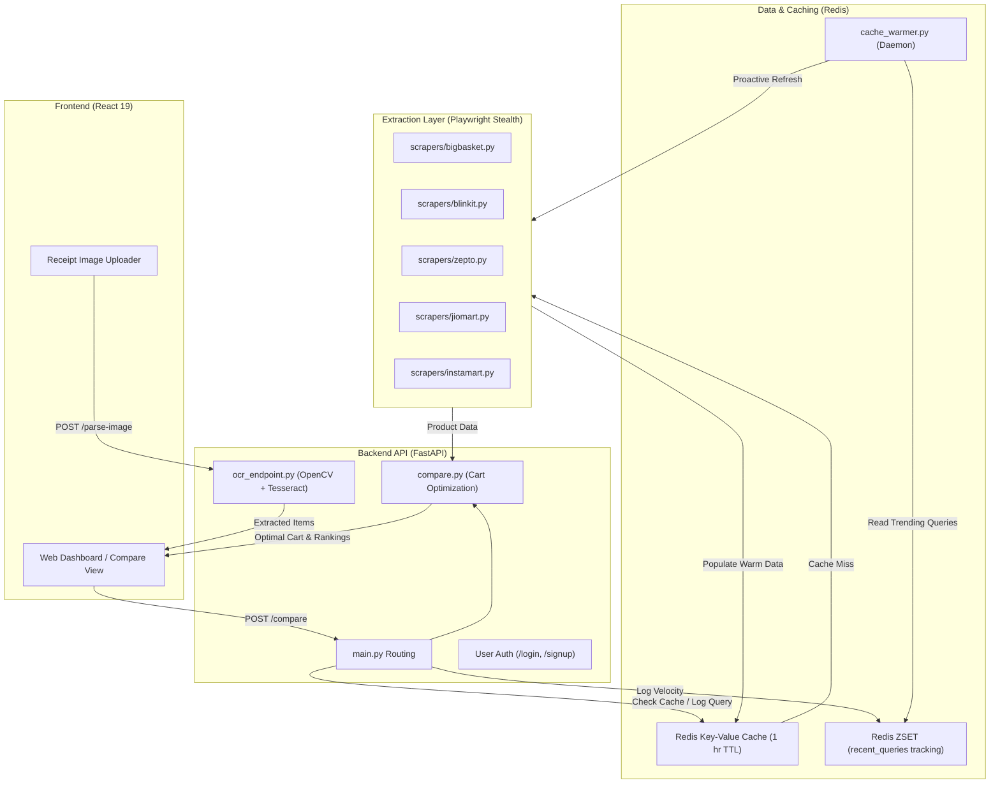

# 🛒 BuyWise - Smart Quick-Commerce Price Comparison & Cart Optimizer

[](https://fastapi.tiangolo.com)
[](https://react.dev/)
[](https://redis.io/)
[](https://playwright.dev/)
[](https://opencv.org/)
[](https://opensource.org/licenses/MIT)

**BuyWise** is a full-stack, AI-powered price intelligence and cart optimization platform built for Indian quick-commerce and e-grocery delivery ecosystems. It aggregates live listings across platforms like **Blinkit**, **Zepto**, **BigBasket**, **JioMart**, and **Swiggy Instamart**, normalizes unit quantities (e.g., ₹/kg, ₹/L), and calculates mathematically optimal shopping carts to maximize consumer savings while accounting for platform delivery fees.

---

## 📑 Table of Contents

- [Key Features](#-key-features)
- [System Architecture](#-system-architecture)
- [Project Structure](#-project-structure)
- [Core Workflows & Algorithms](#-core-workflows--algorithms)
  - [1. Parallel Stealth Scraping](#1-parallel-stealth-scraping)
  - [2. Quantity & Unit Price Normalization](#2-quantity--unit-price-normalization)
  - [3. Cart Optimization Engine](#3-cart-optimization-engine)
  - [4. Redis Caching & Background Daemon](#4-redis-caching--background-daemon)
  - [5. Receipt OCR & Parsing Pipeline](#5-receipt-ocr--parsing-pipeline)
- [Technology Stack](#-technology-stack)
- [API Reference](#-api-reference)
- [Installation & Getting Started](#-installation--getting-started)
  - [Prerequisites](#prerequisites)
  - [1. Clone Repository](#1-clone-repository)
  - [2. Redis Setup](#2-redis-setup)
  - [3. Backend Configuration](#3-backend-configuration)
  - [4. Frontend Configuration](#4-frontend-configuration)
  - [5. Running the Background Cache Warmer (Optional)](#5-running-the-background-cache-warmer-optional)
- [Troubleshooting & FAQs](#-troubleshooting--faqs)

---

## ✨ Key Features

- **⚡ Real-Time Parallel Scraping**: Concurrent data extraction from multiple quick-commerce platforms via stealth Playwright instances configured to avoid bot detection and regional IP traps.
- **⚖️ Apple-to-Apple Unit Price Normalization**: Automatically converts diverse pack sizes (e.g. `500 ml`, `1 L`, `2 x 500 ml`, `Pack of 6`) into standardized reference rates (`₹/L`, `₹/kg`, `₹/piece`), ensuring fair price comparisons.
- **🛒 Smart Multi-Item Cart Optimizer**:
  - Accepts lists of products (e.g., `milk, bread, butter, eggs`).
  - **Split Cart**: Uses exact combinatorial optimization (backtracking / branch-and-bound) to split purchases across platforms when item savings outweigh added delivery fees.
  - **Single Cart**: Identifies the single best store with lowest landed cost and delivery penalty mitigation.
- **⚡ Two-Tier Redis Caching & Auto-Warmer**:
  - Low-latency sub-second response times for cached searches (1-hour TTL).
  - Background daemon monitors query velocity using Redis Sorted Sets (`ZSET`) and proactively re-scrapes trending items under concurrency control.
- **🧾 OCR Grocery Receipt Scanner**: Upload shopping receipts or handwritten lists to automatically extract product names using OpenCV preprocessing and Tesseract OCR.
- **🎨 Modern React UI**: Modern interface with price distribution bar charts, direct platform redirect links, real-time savings badges, and authentication.

---

## 🏛 System Architecture



---

## 📂 Project Structure

```text
BuyWise/
├── backend/
│   ├── main.py                 # FastAPI application, CORS, endpoints, parallel coordination
│   ├── scraper_service.py      # Cache orchestrator (Redis get/set & scraper delegation)
│   ├── redis_client.py         # Redis connection instance with timeout handling
│   ├── compare.py              # Comparison logic, ranking, and cart optimization algorithms
│   ├── quantity_utils.py       # Regex unit parsing, normalization, unit pricing & candidate matching
│   ├── ocr_endpoint.py         # Receipt image upload, OpenCV image preprocessing & Tesseract OCR
│   ├── cache_warmer.py         # Background daemon refreshing trending queries
│   ├── requirements.txt        # Backend Python dependencies
│   ├── cache/
│   │   ├── items.txt           # Pre-warm seed query list (milk, bread, etc.)
│   │   └── preload_cache.py    # Seed population script
│   └── scrapers/
│       ├── scraper.py          # Unified scraper coordinator (scrape_all)
│       ├── browser_utils.py    # Stealth Playwright configuration (anti-detection scripts)
│       ├── bigbasket.py        # BigBasket Playwright scraper
│       ├── blinkit.py          # Blinkit Playwright scraper
│       ├── zepto.py            # Zepto Playwright scraper (with geolocation & cookie bypass)
│       ├── jiomart.py          # JioMart Playwright scraper
│       └── instamart.py        # Swiggy Instamart Playwright scraper
├── frontend/
│   ├── public/                 # Static assets, HTML shell, icons
│   ├── src/
│   │   ├── components/
│   │   │   └── Navbar.jsx      # Navigation bar with authentication state
│   │   ├── pages/
│   │   │   ├── LoginPage.jsx   # Interactive authentication / login view
│   │   │   └── CreateAccount.jsx # User signup page
│   │   ├── App.js              # Application router, state management & API handling
│   │   ├── AppContent.js       # Reusable UI widgets (PlatformCard, BarRow, Badge) & metadata
│   │   ├── HomePage.js         # Interactive landing page with typewriter search & trending items
│   │   ├── ComparePage.js      # Core comparison dashboard, split-cart card & charts
│   │   ├── DealsPage.js        # Curated deals and discount tracker
│   │   ├── AboutPage.js        # Architecture documentation & interactive tech overview
│   │   ├── App.css             # Comprehensive CSS design system with micro-interactions
│   │   └── index.js            # React root mount
│   └── package.json            # Node.js dependencies and scripts
└── README.md                   # Project documentation
```

---

## 🔬 Core Workflows & Algorithms

### 1. Parallel Stealth Scraping
Implemented in [`backend/scrapers/`](file:///c:/Users/riyav/OneDrive/Desktop/BuyWise/backend/scrapers):
- **Bot Detection Evasion**: Configured in [`backend/scrapers/browser_utils.py`](file:///c:/Users/riyav/OneDrive/Desktop/BuyWise/backend/scrapers/browser_utils.py) via Chromium launch arguments (`--disable-blink-features=AutomationControlled`, `--no-sandbox`), custom `User-Agent` strings, and init scripts removing `navigator.webdriver`.
- **Parallel Gathering**: Handled in [`scrape_all_platforms`](file:///c:/Users/riyav/OneDrive/Desktop/BuyWise/backend/scrapers/scraper.py#L26) using `asyncio.gather(*tasks, return_exceptions=True)`.
- **Platform Handling**:
  - **Blinkit**: Scrapes product names, dynamic pricing, and package sizes from text tags.
  - **Zepto**: Bypasses location selection modals by pre-injecting coordinate and address cookies (`user_address`).
  - **BigBasket**: Queries DOM structures for landed discount prices and multipack descriptions.

### 2. Quantity & Unit Price Normalization
Implemented in [`backend/quantity_utils.py`](file:///c:/Users/riyav/OneDrive/Desktop/BuyWise/backend/quantity_utils.py):
- **Regex Parsing**: Identifies single units (`500ml`, `1.5 L`, `750g`, `1 kg`), multipacks (`2 x 500 ml`, `6 x 200g`), and count packs (`Pack of 6 eggs`).
- **Base Units**: Converts volume to millilitres ($ml$), weight to grams ($g$), and items to pieces ($piece$).
- **Normalized Unit Rates**:
  $$\text{Unit Price}_{\text{volume}} = \frac{\text{Price}}{\text{Volume (ml)}} \times 1000 \quad (₹/\text{L})$$
  $$\text{Unit Price}_{\text{weight}} = \frac{\text{Price}}{\text{Weight (g)}} \times 1000 \quad (₹/\text{kg})$$
- **Dimension Isolation**: Prevents invalid comparisons between disparate dimensions (e.g. comparing litres of milk to kilograms of paneer).

### 3. Cart Optimization Engine
Implemented in [`backend/compare.py`](file:///c:/Users/riyav/OneDrive/Desktop/BuyWise/backend/compare.py):
Given a list of $N$ items, each platform $P$ incurs a delivery fee $D_P$ (scraped or defaulted to ₹15–₹30). The engine selects an algorithm dynamically based on cart size $N$:

| Cart Size ($N$) | Algorithm | Function | Details |
| :--- | :--- | :--- | :--- |
| **$N \le 8$** | Exact Backtracking | [`optimize_small_cart`](file:///c:/Users/riyav/OneDrive/Desktop/BuyWise/backend/compare.py#L50) | Exhaustively tests all assignments $P^N$, adding $D_P$ once per distinct platform used. |
| **$9 \le N \le 20$** | Branch and Bound | [`optimize_medium_cart`](file:///c:/Users/riyav/OneDrive/Desktop/BuyWise/backend/compare.py#L91) | Evaluates high price-variance items first; prunes branches where $\text{current cost} + \sum \min(\text{remaining}) \ge \text{best cost}$. |
| **$N > 20$** | Greedy Consolidation | [`optimize_large_cart`](file:///c:/Users/riyav/OneDrive/Desktop/BuyWise/backend/compare.py#L162) | Assigns each item to its cheapest platform, then iteratively consolidates orders to drop redundant delivery fees. |

The optimizer returns:
1. **Split Cart**: Optimal combination of stores to minimize total spend.
2. **Single Cart**: Best single platform (evaluated with missing item penalties) to minimize shipping overhead.

### 4. Redis Caching & Background Daemon
Implemented in [`backend/scraper_service.py`](file:///c:/Users/riyav/OneDrive/Desktop/BuyWise/backend/scraper_service.py) and [`backend/cache_warmer.py`](file:///c:/Users/riyav/OneDrive/Desktop/BuyWise/backend/cache_warmer.py):
- **1-Hour TTL**: Every scrape result is stored as JSON under key `<product_name>` with a 3600-second expiration.
- **Search Analytics**: Queries are logged in Redis Sorted Set `recent_queries` with the current epoch timestamp: `ZADD recent_queries <timestamp> <query>`.
- **Cache Warmer Daemon**:
  - Periodically prunes searches older than 24 hours (`ZREMRANGEBYSCORE`).
  - Fetches active queries from the last 4 hours (`ZRANGEBYSCORE`).
  - Re-scrapes queries in the background using an `asyncio.Semaphore(3)` to cap memory and CPU usage.

### 5. Receipt OCR & Parsing Pipeline
Implemented in [`backend/ocr_endpoint.py`](file:///c:/Users/riyav/OneDrive/Desktop/BuyWise/backend/ocr_endpoint.py):
- **Computer Vision Pipeline**:
  1. Image bytes decoded via OpenCV (`cv2.imdecode`).
  2. Converted to grayscale (`cv2.cvtColor`).
  3. $2\times$ bicubic upscaling (`cv2.resize`) for low-DPI receipts.
  4. Adaptive Gaussian Thresholding (`cv2.adaptiveThreshold`) to isolate text from background glare.
  5. Median blur filter (`cv2.medianBlur`) to eliminate noise.
- **Extraction**: Processed through Tesseract (`--oem 3 --psm 4`). Cleaned with regex to remove non-product invoice terms (`total`, `amount`, `gst`, `tax`).

---

## 💻 Technology Stack

### Backend
- **Framework**: [FastAPI](https://fastapi.tiangolo.com/) (Python 3.10+)
- **Server**: [Uvicorn](https://www.uvicorn.org/) (ASGI)
- **Browser Automation**: [Playwright](https://playwright.dev/python/) (Async Chromium)
- **Cache & Analytics**: [Redis](https://redis.io/) (`redis-py`)
- **Computer Vision & OCR**: [OpenCV](https://opencv.org/) (`opencv-python`), [Pillow](https://python-pillow.org/), [pytesseract](https://pypi.org/project/pytesseract/)
- **Validation**: [Pydantic](https://docs.pydantic.dev/)

### Frontend
- **Framework**: [React 19](https://react.dev/)
- **Routing**: [React Router 7](https://reactrouter.com/)
- **HTTP Client**: [Axios](https://axios-http.com/)
- **Styling**: Pure Modular Vanilla CSS (Glassmorphism, CSS Grid, Responsive Animations)

---

## 📡 API Reference

### 1. `POST /compare`
Executes parallel multi-item comparison and cart optimization.

**Request Body:**
```json
{
  "items": ["amul milk 500ml", "brown bread", "eggs"],
  "required_quantity": 2.0,
  "required_unit": "L"
}
```

**Response Example:**
```json
{
  "items": ["amul milk 500ml", "brown bread", "eggs"],
  "by_product": {
    "amul milk 500ml": {
      "all": [
        {
          "platform": "blinkit",
          "product_name": "Amul Gold Milk",
          "price": 33.0,
          "package_display": "500 ml",
          "unit_price_display": "₹66/L",
          "delivery": 15.0,
          "is_best_deal": true,
          "product_url": "https://blinkit.com/..."
        }
      ],
      "best": { ... },
      "best_unit_price": { ... }
    }
  },
  "optimized": {
    "split_cart": {
      "items": [ ... ],
      "items_cost_inr": 185.0,
      "delivery_cost_inr": 30.0,
      "total_cost_inr": 215.0,
      "platforms_used": ["blinkit", "zepto"],
      "path_used": "backtracking"
    },
    "single_cart": {
      "platform": "blinkit",
      "total_cost_inr": 235.0,
      "missing_items": []
    }
  }
}
```

### 2. `POST /parse-image`
Uploads a receipt image and returns parsed item lines.

**Request:** `multipart/form-data` with `file: <binary image>`

**Response:**
```json
{
  "items": [
    "amul taaza milk",
    "britannia brown bread",
    "farm eggs 6pcs"
  ],
  "raw_text": "Amul Taaza Milk 500ml Rs 27\nBritannia Brown Bread Rs 45\n..."
}
```

### 3. `POST /signup` & `POST /login`
User authentication endpoints for session persistence.

**Request Body:**
```json
{
  "name": "Alex",
  "email": "alex@example.com",
  "password": "securepassword123"
}
```

---

## 🚀 Installation & Getting Started

### Prerequisites
- **Python**: `v3.10` or higher
- **Node.js**: `v18.0.0` or higher & `npm`
- **Redis Server**: Installed locally on port `6379` or running in Docker
- **Tesseract OCR Engine**: Required for receipt parsing ([Download installer for Windows](https://github.com/UB-Mannheim/tesseract/wiki))

---

### 1. Clone Repository
```bash
git clone https://github.com/riyav910/BuyWise.git
cd BuyWise
```

---

### 2. Redis Setup

#### Option A: Docker (Recommended)
```bash
docker run -d --name buywise-redis -p 6379:6379 redis:alpine
```

#### Option B: Native Windows (WSL or Memurai)
Ensure Redis is running locally on `localhost:6379`. You can verify connection with:
```bash
redis-cli ping
# Expected output: PONG
```

---

### 3. Backend Configuration

1. Navigate to the backend directory:
   ```bash
   cd backend
   ```

2. Create and activate a Python virtual environment:
   ```bash
   # Windows (PowerShell)
   python -m venv venv
   .\venv\Scripts\Activate.ps1

   # Linux / macOS
   python3 -m venv venv
   source venv/bin/activate
   ```

3. Install required Python packages:
   ```bash
   pip install -r requirements.txt
   ```

4. Install Playwright browser dependencies:
   ```bash
   playwright install chromium
   ```

5. *(Optional for Receipt OCR)* Verify Tesseract Path:
   Ensure Tesseract is installed at `C:\Program Files\Tesseract-OCR\tesseract.exe` or update the path in [`backend/ocr_endpoint.py`](file:///c:/Users/riyav/OneDrive/Desktop/BuyWise/backend/ocr_endpoint.py#L55).

6. Start the FastAPI development server:
   ```bash
   uvicorn main:app --reload --port 8000
   ```
   The backend API will be available at [http://127.0.0.1:8000](http://127.0.0.1:8000). Interactive Swagger API docs are viewable at [http://127.0.0.1:8000/docs](http://127.0.0.1:8000/docs).

---

### 4. Frontend Configuration

1. Open a new terminal and navigate to the frontend directory:
   ```bash
   cd frontend
   ```

2. Install dependencies:
   ```bash
   npm install
   ```

3. Start the React development server:
   ```bash
   npm start
   ```
   The application dashboard will automatically open at [http://localhost:3000](http://localhost:3000).

---

### 5. Running the Background Cache Warmer (Optional)

To keep frequently searched grocery items pre-cached and ensure instantaneous comparisons for users:

```bash
cd backend
python cache_warmer.py --interval 60
```
**Flags:**
- `--interval <seconds>`: Refresh cycle frequency (default: 60s).
- `--visual`: Opens visible browser windows for debugging scraper execution instead of headless mode.

To populate standard grocery items (milk, bread, eggs, etc.) immediately into cache:
```bash
python cache/preload_cache.py
```

---

## 🛠 Troubleshooting & FAQs

#### Q: Playwright scrapers fail with `TimeoutError` or `Access Denied`?
- Quick-commerce sites frequently update DOM selectors and deploy anti-bot protections. Ensure Playwright's Chromium is up to date (`playwright install chromium`).
- For Zepto, location cookies are automatically injected. Verify your IP is routed within an active quick-commerce service region (India).

#### Q: OCR returns "Tesseract is not installed or not in PATH"?
- Install Tesseract OCR from [UB-Mannheim/tesseract](https://github.com/UB-Mannheim/tesseract/wiki).
- Verify the binary path in [`backend/ocr_endpoint.py`](file:///c:/Users/riyav/OneDrive/Desktop/BuyWise/backend/ocr_endpoint.py#L55) matches your local installation directory.

#### Q: Redis connection fails on backend startup?
- Ensure Redis server is active: run `redis-cli ping`.
- If running on a non-default port or host, adjust connection settings in [`backend/redis_client.py`](file:///c:/Users/riyav/OneDrive/Desktop/BuyWise/backend/redis_client.py).

---

## 📄 License

This project is licensed under the MIT License.
